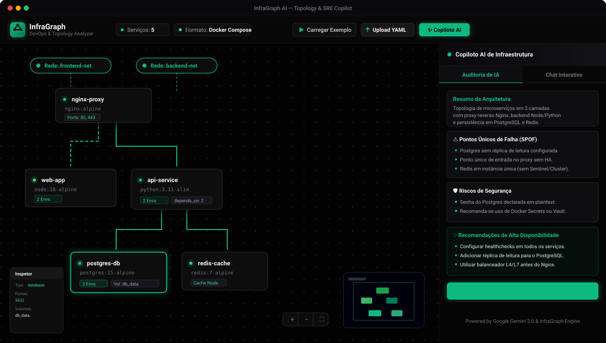
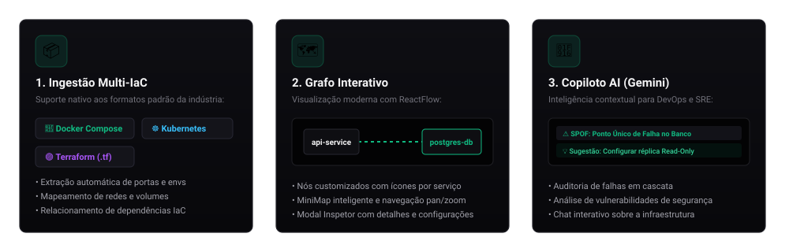

<div align="center">

# InfraGraph AI
### Visualizador Interativo de Topologia e Auditoria de Infraestrutura com IA

[](https://github.com/fhbertho/the_infograph/actions/workflows/ci.yml)
[](https://fastapi.tiangolo.com)
[](https://react.dev)
[](https://reactflow.dev)
[](https://aistudio.google.com)
[](LICENSE)

<br/>

O **InfraGraph AI** é uma plataforma moderna para equipes de **DevOps, SRE e Engenharia de Infraestrutura**. Ele transforma arquivos de configuração (`docker-compose.yml`, Kubernetes Manifests `.yaml` e scripts Terraform `.tf`) em um **diagrama de topologia interativo em tempo real**, acoplado a um **Copiloto de IA inteligente (Google Gemini)** para diagnósticos arquiteturais, detecção de riscos de segurança e simulação de falhas.

<br/>

<!-- Preview da Interface da Aplicação -->
<p align="center">
  
</p>

</div>

---

## 🎯 Pilares Principais

<p align="center">
  
</p>

<br/>

### 1. 🗺️ Topologia Interativa de Alta Fidelidade
- **Navegação Fluida:** Zoom infinito, Pan, MiniMap com categorização visual por cores e tela cheia.
- **Nós Contextuais:** Cada serviço exibe sua respectiva imagem de contêiner, portas mapeadas no host e contagem de variáveis de ambiente.
- **Mapeamento de Redes e Volumes:** Conexões tracejadas inteligentes conectam serviços às suas respectivas sub-redes virtuais e volumes compartilhados.
- **Inspetor Lateral:** Clique em qualquer componente para inspecionar parâmetros avançados e dependências.

### 2. 🤖 Copiloto AI para SRE e DevOps (Google Gemini)
- **Diagnóstico Automático (Auditoria):**
  - **Identificação de SPOFs:** Detecta pontos únicos de falha onde a queda de uma única instância pode derrubar toda a aplicação.
  - **Auditoria de Segurança:** Alerta sobre portas sensíveis expostas desnecessariamente e credenciais estáticas em arquivos.
  - **Recomendações Práticas:** Sugestões práticas de resiliência, réplicas de leitura e balanceamento de carga.
- **Chat Interativo:**
  - Faça perguntas como *"O que acontece se o PostgreSQL cair?"* e a IA simula o impacto em cascata nos serviços dependentes.
  - Modo heurístico integrado: funciona mesmo sem chave de API para fins de demonstração.

### 3. 📦 Suporte Multi-Formato (IaC)
| Formato | O que o InfraGraph extrai |
| :--- | :--- |
| **Docker Compose** (`docker-compose.yml`) | Serviços, redes, dependências (`depends_on`), portas, volumes e variáveis de ambiente |
| **Kubernetes** (`.yaml`) | Deployments, StatefulSets, Services, Ingress, Pods, ConfigMaps e rotas HTTP |
| **Terraform** (`.tf`) | Recursos de nuvem (AWS VPC, Security Groups, ALB, RDS, EC2) e referências cruzadas |

---

## 🚀 Como Executar o Projeto

### Pré-requisitos
- **Python 3.10+**
- **Node.js 18+**

---

### Opção A: Inicialização Automatizada com 1 Comando (Recomendado no Windows)

Criamos um script que sobe o Backend e o Frontend simultaneamente em janelas dedicadas:

```powershell
./start.ps1
```

*(Ao pressionar qualquer tecla na janela principal, ambos os serviços serão encerrados de forma limpa).*

---

### Opção B: Inicialização Manual Passo a Passo

#### 1. Iniciar o Backend (FastAPI)
```bash
cd backend
pip install -r requirements.txt
python main.py
```
> O servidor FastAPI estará disponível em **`http://localhost:8000`** (Documentação Swagger em **`http://localhost:8000/docs`**).

**Configuração do Gemini AI (Opcional):**
Crie um arquivo `.env` dentro da pasta `backend/`:
```env
GEMINI_API_KEY=sua_chave_aqui
```
*(Obtenha uma chave gratuita em [Google AI Studio](https://aistudio.google.com/)).*

#### 2. Iniciar o Frontend (React + Vite)
```bash
cd frontend
npm install
npm run dev
```
> Acesse a interface web em **`http://localhost:5173`**.

---

## 🛠️ Stack Tecnológica

- **Frontend:**
  - [React 19](https://react.dev/) — Interface declarativa de alta performance.
  - [@xyflow/react (ReactFlow v12)](https://reactflow.dev/) — Motor gráfico vetorial para diagramas de nós e conexões.
  - [Lucide Icons](https://lucide.dev/) — Ícones minimalistas para identificação de serviços.
  - [Vite](https://vitejs.dev/) — Ferramenta de build e HMR ultrarrápido.
  - [Axios](https://axios-http.com/) — Comunicação assíncrona com o backend.

- **Backend:**
  - [Python 3](https://www.python.org/) + [FastAPI](https://fastapi.tiangolo.com/) — API REST assíncrona.
  - [PyYAML](https://pyyaml.org/) — Parser sintático de documentos YAML e múltiplos manifestos.
  - [Google GenAI SDK](https://github.com/google-gemini/generative-ai-python) (`google-genai`) — Integração direta com modelos Gemini 2.0.
  - [Uvicorn](https://www.uvicorn.org/) — Servidor ASGI ultraleve.

- **DevOps & CI/CD:**
  - [GitHub Actions](https://github.com/features/actions) — Pipeline automatizada de compilação, sintaxe e build a cada push.

---

## 📁 Estrutura do Repositório

```text
infragraph/
├── .github/workflows/ci.yml    # Pipeline de CI/CD automatizada
├── backend/
│   ├── main.py                 # Rotas da API e endpoints REST
│   ├── requirements.txt        # Dependências Python
│   ├── .env.example            # Template de variáveis de ambiente
│   ├── parsers/                # Motores de interpretação sintática
│   │   ├── docker_parser.py    # Parser de Docker Compose
│   │   ├── k8s_parser.py       # Parser de Kubernetes Manifests
│   │   └── tf_parser.py        # Parser de scripts Terraform
│   └── services/
│       └── ai_service.py       # Integração com Google Gemini 2.0
├── frontend/
│   ├── src/
│   │   ├── App.jsx             # Estado global, upload e modais
│   │   ├── components/
│   │   │   ├── Header.jsx      # Barra superior com estatísticas e upload
│   │   │   ├── GraphCanvas.jsx # Canvas do ReactFlow e controles
│   │   │   ├── CustomNodes.jsx # Componentes visuais dos nós
│   │   │   └── AICopilot.jsx   # Painel lateral do Copiloto de IA
│   │   └── index.css           # Tema escuro e tipografia
│   └── package.json            # Dependências React/Vite
├── docs/images/                # Recursos visuais da documentação
├── samples/                    # Exemplos prontos para teste imediato
│   ├── main.tf
│   └── terraform_example.tf
└── start.ps1                   # Script de inicialização automatizada fullstack
```

---

<div align="center">
Desenvolvido por <a href="https://github.com/fhbertho">Felipe Bertho</a>
</div>
